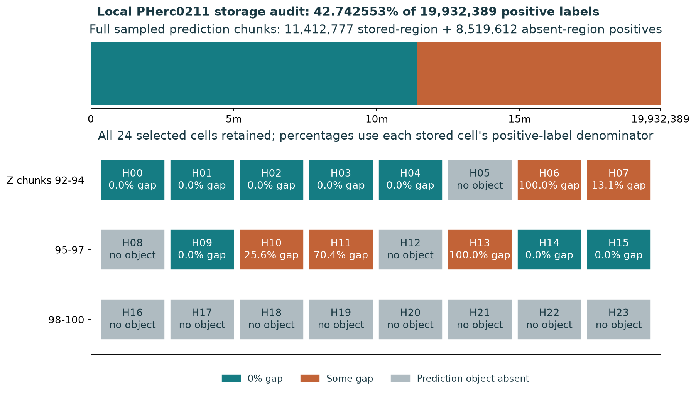
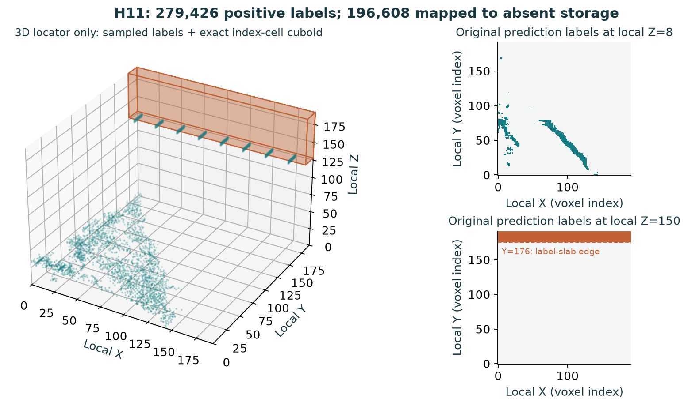

# ARGUS Surface Support

ARGUS audits positive surface-prediction labels against masked-CT storage coverage, retaining a traceable record of source bytes, selection and counting.

**Reviewed source v0.4.3 | PHerc.211 | October 2026.** Experimental research quality assurance: physical registration, papyrus identity, false-surface identification, ink and writing are **not established**. No prize decision or Vesuvius affiliation is implied. [Why 0.4.3 replaces the supplied 0.4.2](CHANGES_0_4_3.md).

## Why storage auditing matters

A virtual-unwrapping workflow needs to distinguish predictions from the data supporting their interpretation. An attractive surface rendering does not show whether its nominal coordinates fall in stored masked-CT objects. ARGUS records that narrower question so a reviewer can identify what requires investigation. Practical downstream benefit remains to be benchmarked.

## Verified local findings

The frozen local sample selects **24 prediction-grid cells** from 423 eligible cells in an already selected R04 region, excluding 18 earlier inspected keys. Selection regenerates exactly; a hash alone does not independently establish when the plan was fixed or whether outcomes were unseen.

| Archived observation | Result and denominator |
|---|---:|
| Prediction storage | 13 stored / 24 cells; 11 absent / 24 |
| Positive labels in 13 stored prediction chunks | 19,932,389 |
| Positives nominally in absent masked-CT storage | 8,519,612 / 19,932,389 = 42.742553% |
| Positives nominally in stored masked-CT regions | 11,412,777 / 19,932,389 |
| Stored chunks with some absent-storage positives | 5 / 13; 2 / 13 entirely in absent-storage regions |
| Archived CT-object inventory | 186 keys: 75 stored, 111 absent; 212 HTTP receipts overall |

Counts use **whole prediction chunks**, not clipping to R04. The ratio is positive-voxel weighted within this local sample, not whole-scroll prevalence or a physical false-surface rate. Separately implemented counters agree on the same archived bytes and local receipts; this is not external researcher replication or fresh server attestation. [Evidence and qualifications](SUBMISSION_EVIDENCE_SUMMARY.md).



*Source-derived counts. Teal: positives in stored CT-object regions; orange: absent-object regions. Units are labels/cells, not physical papyrus area. [Captions and provenance](figures/FIGURE_CAPTIONS.md).*

## H11: original labels and exact block

Prediction chunk `96/32/23` contains **279,426 positive labels**. Of these, 196,608 nominally map to absent masked-CT storage and 82,818 to stored regions. The absent-storage positives exactly equal local voxel block `Z[128,192), Y[176,192), X[0,192)` = **64 x 16 x 192**. The entire positive mask also contains the 82,818 stored-region positives.



*Prediction-label slices, not original CT intensity slices. The 3D panel is a label locator, not papyrus anatomy. The CT storage transition is local **Z=128**; **Y=176** is the label-slab edge. Source Blosc SHA256: `28676496bf281c635598ca4d3816dce9890ef5e7a03121207ab73280e17ec1c7`.*

[Exact original-array block proof](figures/07_H11_EXACT_SLAB_RAW_DATA_PROOF.png) and [interpretation](figures/06_07_H11_FIGURE_CAPTIONS_AND_LIMITS.md). The block predates mesh coarsening; its cause and physical significance remain unresolved.

## How it works

1. Validate frozen metadata, historical exclusions and deterministic selection fingerprints.
2. Capture only selected prediction objects and intersecting masked-CT object statuses, retaining hashes and request receipts. Failures remain unknown.
3. Decode stored labels and partition each full prediction chunk by nominal CT-chunk intersections.
4. Recount independently and publish denominators, provenance and limitations.

[Method and validity gates](figures/04_METHOD_AND_VALIDITY_GATES.png). Existing capture ZIPs are preserved rather than overwritten.

## Installation and offline reproduction

Python 3.10+ is declared; [validation results](docs/VALIDATION.md) identify actual tested versions. No GPU is required. From a source checkout on Linux:

```bash
python3 -m venv .venv
source .venv/bin/activate
python -m pip install ".[verification]"
python -m unittest discover -s tests -v
python tools/heldout_capture.py --dry-run
argus-surface-support --help
python tools/check_release.py
```

On Windows PowerShell:

```powershell
py -3 -m venv .venv
.venv\Scripts\python.exe -m pip install ".[verification]"
.venv\Scripts\python.exe -m unittest discover -s tests -v
.venv\Scripts\python.exe tools/heldout_capture.py --dry-run
.venv\Scripts\argus-surface-support.exe --help
```

`--dry-run` verifies selection without network access. The installed console command is the point-audit library CLI; capture/verification tools run from the source checkout. Offline tests use synthetic in-memory fixtures and download no CT data.

Replay the **already-public historical** capture offline:

```bash
python tools/heldout_verify.py ARGUS_04_HELDOUT_CAPTURE.zip --out HELDOUT_ANALYSIS
python tools/verify_heldout_vectorized.py ARGUS_04_HELDOUT_CAPTURE.zip --out RELEASE_REPLAY_VECTOR
python -O tools/review_release.py ARGUS_04_HELDOUT_CAPTURE.zip --out RELEASE_REPLAY_EXPLICIT
```

The historical vectorized verifier requires normal Python because it uses assertions; the explicit-check independent verifier also works under `-O`. No replay makes live HTTP requests. Earlier six-case raw archives are not bundled; their checked aggregates are descriptive context.

### Optional fresh network capture

```bash
python tools/heldout_capture.py --output ARGUS_04_HELDOUT_CAPTURE_NEW.zip
python tools/heldout_verify.py ARGUS_04_HELDOUT_CAPTURE_NEW.zip --out HELDOUT_ANALYSIS_NEW
```

This makes live requests to frozen official endpoints and can download up to 125 MB. Remote data may have changed: changed metadata or unknown network states are not historical replication. Capture uses Python built-ins; decoding requires the verification extra. Windows `RUN_HELDOUT_24.cmd` creates a new uniquely named capture. `RUN_VERIFY_CAPTURE.cmd` defaults to the existing historical capture; pass a new ZIP path as its first argument to verify that run. Both preserve error codes. Set `ARGUS_PYTHON` to `.venv\Scripts\python.exe` if needed. Existing ZIPs are never replaced. [Data restrictions](docs/DATA_RIGHTS_AND_PRIOR_ART.md).

## Repository navigation

| Location | Purpose |
|---|---|
| [argus_support](argus_support/) | Library and installed CLI |
| [tools](tools/) and [tests](tests/) | Capture, offline replay and regression tests |
| [protocol](protocol/) | Frozen plan, hash, exclusions and metadata |
| [evidence](evidence/) | Derived reports and release replay results |
| [figures](figures/) | Source-derived PNG/SVG figures, captions and provenance |
| [research](research/) | Dossier and proposed research roadmap |
| [docs](docs/) | Audit, validation, rights, prior art and scientific limits |
| [File inventory](docs/FILE_AUDIT.csv) | Received/live file comparison and disposition |

## Scientific limitations and prior art

Missing **masked-CT storage** is not proof of missing original CT or physical papyrus. Equal nominal ZYX indices do not independently validate registration. The sample is local and spatially dependent; all eight upper-Z-stratum predictions were absent. No confidence interval, p-value, model-accuracy or scroll-wide claim follows from these counts.

Schurkai's [vesuvius-phantom-audit](https://github.com/Schurkai/vesuvius-phantom-audit) already provides chunk- and voxel-level auditing and cleanup. ARGUS claims neither priority nor demonstrated superiority. A pinned overlap-function comparison agreed for 24/24 cells; a full matched pipeline benchmark remains future work. [Baseline](docs/BASELINE_AND_NOVELTY.md) and [registration requirements](docs/REGISTRATION_AND_PHYSICAL_VALIDATION.md).

## Dossier and November-December roadmap

The [reviewed eight-page dossier](research/ARGUS_RESEARCH_DOSSIER.pdf) supersedes the received seven-page version so scientific corrections and evidence levels are explicit. The [critical path](research/NOV_DEC_2026_CRITICAL_PATH.md), [executive brief](research/NOV_DEC_EXECUTIVE_BRIEF.md) and [three-page proposal](research/NOV_DEC_PROPOSAL_BRIEF.pdf) describe conditional future work. See the [roadmap figure](figures/05_NOV_DEC_CRITICAL_PATH.png) and [release gates](docs/RELEASE_CHECKLIST.md).

## About the author

I'm Spencer Tropea, an independent Canadian creator and researcher with a background in communications and an interest in history and cultural preservation. Recovering ancient writing inspired ARGUS; its technical focus became making computational claims traceable to evidence. Argus Panoptes is a metaphor for careful observation and acknowledging uncertainty. These scrolls represent real people's intellectual lives, and I approach them with respect. [Complete introduction](ABOUT_ARGUS_AND_AUTHOR.md).

## Licensing, attribution and collaboration

Original ARGUS software and prose are [MIT licensed](LICENSE). Third-party datasets, predictions and data-derived imagery retain their own terms. The historical capture was already public before this release; preserving it does not resolve prediction-asset redistribution terms. No new raw data is added. [Rights and attribution](docs/DATA_RIGHTS_AND_PRIOR_ART.md) and [license scope](docs/LICENSING.md).

Scientific criticism, reproduction reports and integration ideas are welcome through [GitHub issues](https://github.com/Troptrops/ARGUS/issues). Source publication is separate from competition submission; no competition form is submitted automatically.
